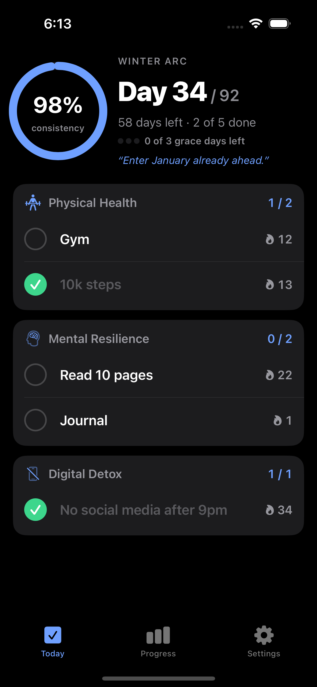
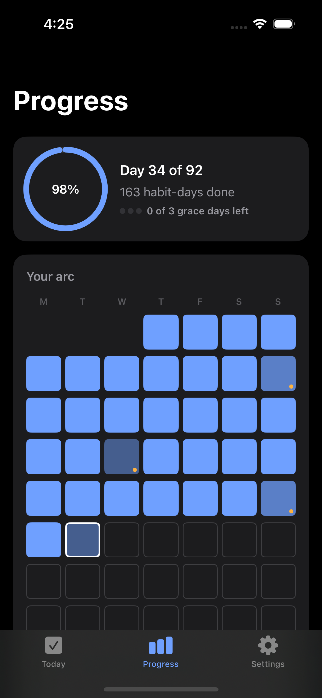
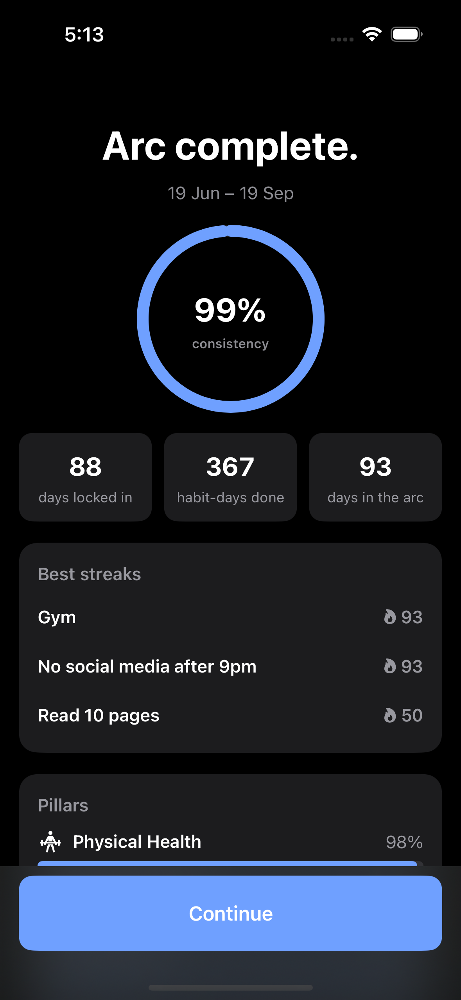

# Winter Arc Specs

This reporsitory contains the specs, design decision walkthrough and videos for the app and not the code.Winter arc app is an offline-first iOS habit tracker built for one specific thing: running a **Winter Arc** — a
time-boxed stretch (classically Oct 1 – Dec 31) of daily non-negotiables, grouped into pillars,
with a hard start, a hard end and a countdown.

General habit apps are built for open-ended, forever habits. An arc is the opposite, and the
difference shows up everywhere: the day counter is the hero, a miss costs whatever your ruleset
says it costs, and the whole thing ends on a summary you can look back on.

| Today | Progress | Arc complete |
|---|---|---|
|  |  |  |

## What it does

- **Set up an arc** in under three minutes — dates, 3–5 pillars, 1–3 daily habits each, a ruleset,
  an optional "why" and reminder, and an optional before photo.
- **Check in daily** — one tap per habit, persisted immediately, with per-habit streaks and a
  Consistency Score always visible.
- **Three rulesets** — *Streaks* (default; a miss resets that habit only), *Consistency Score*
  (finish above a target), *Grace Days* (a budget of forgiven misses; one more fails the arc).
- **See where you stand** — a heat-map of the whole arc, per-pillar and per-habit breakdowns,
  weekly reflections, and tap any past day to edit it within the edit window.
- **Join late** — start an arc in the past and mark elapsed days done, missed, or leave them blank
  to backfill.
- **Finish** — an end-of-arc summary, a closing reflection, an after photo beside the before, and
  a read-only archive of every past arc.
- **Home-screen widget** — day count and today's check-in state.

Everything is on-device. No account, no network calls, no analytics.

## How it is built

Spec-driven: every feature traces to a requirement, every screen to the frontend spec, every test
to a case in the test spec. The specs are the source of truth and live in [`specs/`](specs/).

| Spec | What it settles |
|---|---|
| [`winter-arc-concept-spec.md`](specs/winter-arc-concept-spec.md) | What a Winter Arc is — origin, principles, rulesets, vocabulary |
| [`goal-spec.md`](specs/goal-spec.md) | Requirements (FR/NFR), user journeys, milestones |
| [`frontend-spec.md`](specs/frontend-spec.md) | Navigation, every screen, components, design system, accessibility |
| [`data-spec.md`](specs/data-spec.md) | Models, invariants, every derived metric, the rollover algorithm |
| [`test-spec.md`](specs/test-spec.md) | Every test case, cited back to the requirement it verifies |

## Status

M1–M3 are complete: setup, daily check-in, rollover, Progress with the heat-map, day editing,
Settings, restart/abandon/delete, the Grace Days failure flow, the end-of-arc flow, archives,
photos and the widget.

**M4 (ship) is outstanding** — accessibility audit, Dynamic Type pass, performance check,
localization, App Store screenshots, privacy manifest and the listing.

## Design

[`design/`](design/) holds the app icon (layered SVG sources plus the default/dark/tinted
exports), the launch screen artwork, the UI direction mockups and simulator screenshots.
